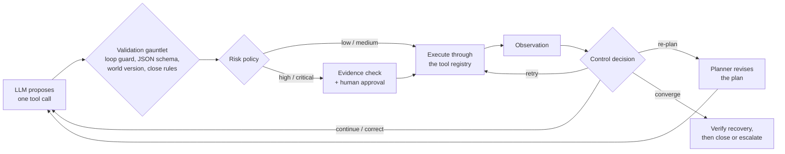

# IncidentZero 🚨

**An autonomous SRE agent that investigates production incidents, fixes them under human
approval, and proves recovery before it closes the ticket.**

[](https://github.com/amnanazir101-maker/incidentzero/actions/workflows/ci.yml)


-555)

IncidentZero puts an LLM in charge of a simulated microservice platform (checkout, payment,
inventory and order services, a Redis cache and an order database) when something breaks. The
model proposes one tool call at a time; a plain-Python runtime decides what actually happens.
It validates every call, rejects actions planned on an outdated view of the system, asks a
human before risky changes, retries transient failures, re-plans when the evidence changes,
and stops only on **verified recovery** or **evidence-backed escalation**, all inside a hard
budget of 14 LLM calls, 28 tool calls and 120 seconds.

No agent framework (LangChain, LangGraph, CrewAI) is used: the point is to engineer the
runtime itself.

## Results

Live runs on Groq with `openai/gpt-oss-20b` and the default budget:

| Scenario | Incident | Outcome | LLM calls | Tool calls | Time |
|---|---|---|---|---|---|
| public-a | Order writes are timing out across the checkout path (SEV-2) | escalated with 10 pieces of evidence | 9 / 14 | 10 / 28 | 108.8 s |
| public-b | Inventory requests are timing out intermittently (SEV-1) | **resolved and verified** | 10 / 14 | 11 / 28 | 119.0 s |
| public-c | Inventory requests are timing out intermittently (SEV-2) | **resolved and verified** | 8 / 14 | 11 / 28 | 111.5 s |

What happened along the way, all handled by the runtime rather than the model:

- **A stale world**: in public-b the system changed between observation and action. The
  action was rejected, the agent re-observed, re-planned and fixed the memory leak it found.
- **Malformed model output**: invalid or unparseable tool calls were corrected with the exact
  schema error instead of aborting the run.
- **Flaky telemetry**: transient tool errors were retried without spending an LLM call.
- **Running out of time**: with ~20 s per model call, a latency-aware guard converged before
  the 120 s limit, verified recovery and closed the incident.
- **No false success**: in public-a the real fix (a critical database failover) was never
  proposed within the budget, so the agent escalated with its evidence instead of claiming a fix.

Offline, the same controller with a local heuristic model resolves all three incidents in
8-10 LLM calls and under 0.1 s. The full analysis is in the
[engineering report](docs/ENGINEERING_REPORT.md), and the [traces](traces/) record every step
of the three live runs.

## How it works



- **The model proposes, Python decides.** Each proposal passes a validation gauntlet,
  cheapest check first, so a call that will be refused never costs tool budget.
- **One of five decisions per observation**: continue, retry, correct, re-plan or abort.
- **Re-planning that keeps progress**: completed steps carry over, rejected hypotheses are fed
  back as "do not repeat", Python owns the revision counter, and a deterministic local revision
  takes over when the model's plan fails the schema or the budget is low.
- **Human approval that cannot be faked**: high and critical actions (rollback, traffic
  shift, database failover) need real evidence about the target service before a human is
  even asked, and only the approval gateway's "yes" executes them.
- **Proof before closure**: an incident closes only by citing a passing `verify_recovery` at the
  latest world version; any later change invalidates that proof.
- **Budget- and time-aware**: the controller projects the next call's latency against the time
  limit and converges early rather than being cut off.
- **A hardened Groq adapter**: strips model control tokens from tool names, recovers the
  attempted call when Groq rejects a generation, and retries only transient errors with
  capped backoff.
- **Every step is traced** to JSONL for replay and diagnosis.

## Quickstart

```bash
git clone https://github.com/amnanazir101-maker/incidentzero.git
cd incidentzero
python -m venv .venv
.venv\Scripts\activate            # macOS/Linux: source .venv/bin/activate
pip install -r requirements.txt

pytest -q tests                                            # 18 tests, no API key needed
python scripts/run_offline.py --student-id 24I-8070 --all  # full agent with a local model
```

`--student-id` seeds the scenario generator: every ID produces different deterministic
incidents. More offline runs:

```bash
python scripts/run_offline.py --student-id 24I-8070 --scenario public-a --deny         # approver says no
python scripts/run_offline.py --student-id 24I-8070 --scenario public-a --interactive  # approve by hand
python scripts/run_offline.py --student-id 24I-8070 --max-llm-calls 4 --max-tool-calls 6  # tight budget
```

**Live with Groq**: copy `.env.example` to `.env`, add your `GROQ_API_KEY`, then:

```bash
python -m incidentzero.cli run --student-id 24I-8070 --scenario public-b
```

High-risk actions pause at the console until you type `APPROVE`.

## Project structure

```
incidentzero/
  agent/controller.py    control loop, validation gauntlet, latency-aware convergence
  agent/planner.py       plan creation and revision
  agent/policies.py      control decisions and loop guard
  agent/recovery.py      bounded retry with backoff
  agent/state.py         explicit agent state, separate from the transcript
  agent/limits.py        budgets loaded from configs/limits.json
  approval/broker.py     evidence check and human approval gate
  model/groq_client.py   Groq tool-calling adapter with error recovery
  model/heuristic.py     offline model for tests and demos
  environment/, tools/, telemetry/   simulator, tool registry, trace and budget helpers
configs/                 risk policy, limits and service topology
tests/student/           10 behaviour tests, one per failure class
tests/public/            contract tests for the simulator and interfaces
scripts/run_offline.py   offline evaluation runner
traces/                  JSONL traces of the three live Groq runs
docs/                    architecture overview and engineering report
```

## Tests

`pytest -q tests` runs 18 tests: 8 contract tests and 10 behaviour tests, one per failure
class: a stale world, the retry bound, an unevidenced critical action, a risk-policy change,
a repeated failed hypothesis, an invented tool, closing without verification, a repeated
action, an approval denial and a reduced budget. They drive the controller with scripted or
local models, so no API key is needed. GitHub Actions also checks that no agent framework is
imported and that the simulator is unmodified, and runs the offline evaluation.

## Credits

Built by **Amna Nazir** ([@amnanazir101-maker](https://github.com/amnanazir101-maker)) for the
Agentic AI course at FAST-NUCES Islamabad (Fall 2026). The simulated environment, tool
registry, configuration files, trace and budget helpers and contract tests come from the course
starter repository; the agent runtime, approval broker, Groq adapter improvements, offline
model, behaviour tests and evaluation runner were built on top of it.
